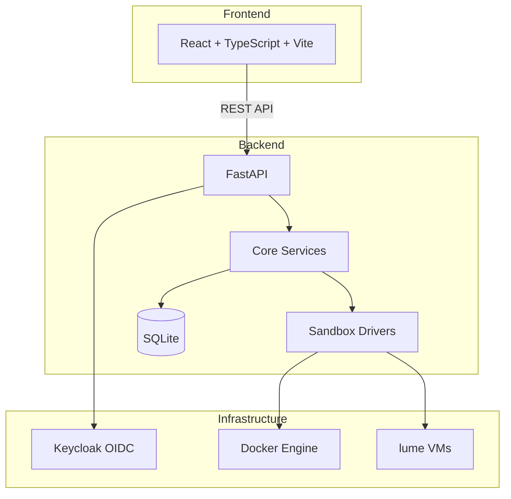

# Cobalt Workbench

> Work in progress. This checkpoint may be incomplete or fail tests. See PLAN.md and STATUS.md before use.


**Scale computer-use 2.0 with open-source drivers, cross-OS sandboxes, and benchmarks for training, evaluation, and data generation.**

*Alan Vo | AI & Machine Learning*

---

## Overview

Cobalt Workbench is a developer tool for AI/ML researchers and engineers building computer-use agents. It provides:

- **Cross-OS sandbox orchestration** — Manage lume VMs and Docker containers with a unified API, including ARM64-native images for Apple Silicon
- **Benchmark runner** — Define and execute evaluation tasks with timing, screenshots, and action traces
- **Training data generation** — Record agent trajectories and export labeled datasets for model training
- **OIDC authentication** — Keycloak-based auth with SAML identity broker support

## Quick Start

### Prerequisites
- Docker and Docker Compose
- Python 3.12+ (for local development)
- Node 24+ (for local frontend development)

### Using Docker Compose (Recommended)

```bash
# Copy environment template
cp .env.example .env

# Start all services (backend, frontend, Keycloak)
docker compose up --build

# Frontend: http://127.0.0.1:8080
# Backend API: http://127.0.0.1:8000
# API docs: http://127.0.0.1:8000/docs
# Keycloak (with --profile auth): http://127.0.0.1:8081
```

### Local Development

**Backend:**
```bash
cd backend
python -m venv .venv
source .venv/bin/activate
pip install -r requirements.txt
pip install -e ".[dev]"
uvicorn app.main:app --reload --host 127.0.0.1 --port 8000
```

**Frontend:**
```bash
cd frontend
npm install
npm run dev
# Frontend at http://127.0.0.1:5173 (proxies /api to backend)
```

## Architecture



## API Reference

### Health Check
```
GET /api/v1/health
```
Returns service health status.

**Response:**
```json
{
  "status": "healthy",
  "version": "1.0.0",
  "timestamp": "2025-01-15T10:30:00Z"
}
```

## Configuration

| Variable | Description | Default |
|----------|-------------|---------|
| `ENVIRONMENT` | Runtime environment | `development` |
| `DATABASE_URL` | SQLite database path | `sqlite+aiosqlite:///./data/app.db` |
| `CORS_ORIGINS` | Allowed CORS origins | `["http://localhost:5173"]` |
| `OIDC_ISSUER_URL` | Keycloak issuer URL | *(empty)* |
| `OIDC_CLIENT_ID` | OIDC client ID | *(empty)* |
| `OIDC_CLIENT_SECRET` | OIDC client secret | *(empty)* |
| `DEMO_MODE` | Enable demo mode (localhost only) | `true` |
| `LLM_API_KEY` | LLM provider API key | *(empty)* |
| `LLM_PROVIDER` | LLM provider type | `openai-compatible` |
| `LLM_MODEL` | Model identifier | *(empty)* |
| `LLM_BASE_URL` | Custom API base URL | *(empty)* |

## Security Limitations

- **Demo mode** binds to `127.0.0.1` only and **refuses to start in production** without explicit configuration
- **No hardcoded credentials** — all secrets via environment variables
- **OIDC tokens validated** with signature, issuer, and audience checks
- **HttpOnly SameSite cookies** with CSRF protection for session auth
- **Server-side LLM keys only** — never exposed to frontend

## SSO / SAML Setup

Keycloak supports upstream SAML IdPs through identity brokering:

1. Configure SAML IdP in Keycloak Admin Console → Identity Providers → SAML v2.0
2. Map SAML attributes to Keycloak user attributes
3. Enable broker for the realm
4. Users can then authenticate via corporate SAML IdP

## LLM Provider Configuration

| Provider | `LLM_PROVIDER` | `LLM_BASE_URL` (default) |
|----------|----------------|--------------------------|
| OpenAI | `openai-compatible` | `https://api.openai.com/v1` |
| Anthropic | `anthropic` | `https://api.anthropic.com` |
| Google Gemini | `gemini` | `https://generativelanguage.googleapis.com` |
| Ollama | `ollama` | `http://localhost:11434` |
| LiteLLM / OpenRouter | `openai-compatible` | Custom |

## Testing

```bash
# Backend tests
cd backend
.venv/bin/python -m pytest

# Frontend tests
cd frontend
npm test
```

## Project Structure

```
cobalt-workbench/
├── backend/
│   ├── app/
│   │   ├── api/           # API routes
│   │   ├── core/          # Config, security
│   │   ├── services/      # Business logic
│   │   ├── models/        # Data models
│   │   └── main.py        # FastAPI entrypoint
│   ├── tests/             # Pytest tests
│   ├── requirements.txt
│   └── pyproject.toml
├── frontend/
│   ├── src/
│   │   ├── components/    # React components
│   │   ├── api/           # Typed API client
│   │   ├── App.tsx
│   │   └── main.tsx
│   ├── tests/             # Vitest tests
│   ├── package.json
│   └── vite.config.ts
├── compose.yaml
├── Dockerfile.backend
├── Dockerfile.frontend
├── .env.example
└── README.md
```

## AI/ML Evaluation

Cobalt Workbench includes a reproducible benchmark harness for evaluating computer-use agents:

```bash
# Run benchmark (future feature)
# cobalt-benchmark run --task-suite web-navigation --agent gpt-4o --sandbox docker
```

**Baseline metrics** (to be measured):
- Task success rate
- Steps per task
- Latency per action
- Token consumption

**Failure cases tracked:**
- Sandbox startup failures
- Action execution errors
- Observation timeouts
- Cross-platform compatibility issues

## License

MIT License — Copyright © 2025 Alan Vo <alanvo@gmail.com>